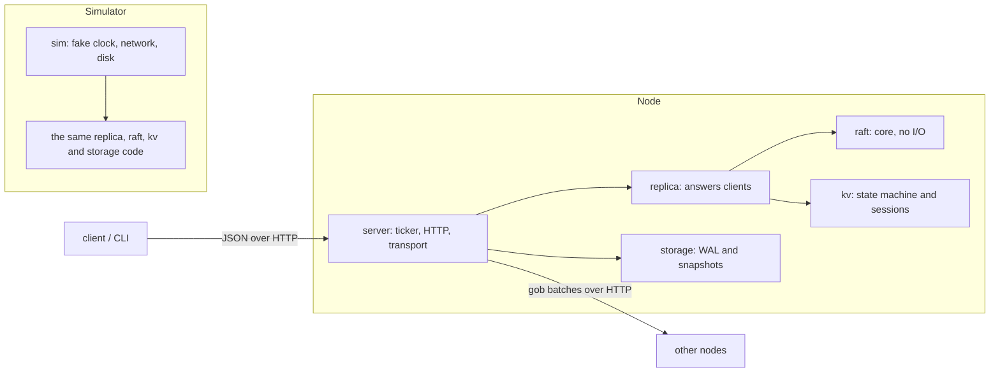

# RaftKV

[](https://github.com/DranzerD/RaftKV/actions/workflows/ci.yml)
[](https://pkg.go.dev/github.com/DranzerD/RaftKV)
[](LICENSE)

A fault-tolerant replicated key-value store with a hand-written Raft consensus layer, following the Raft paper (Ongaro & Ousterhout). A cluster of 3 or 5 nodes keeps serving when a minority crashes or is partitioned away, applies every client write exactly once, and never returns a stale read.

The Raft core is a deterministic state machine with no I/O. The same code runs inside a seeded simulator, where whole clusters are put through crashes, partitions, torn disk writes and message loss, and inside the real server.

## Highlights

- **Raft from scratch** in about 740 lines of Go: leader election, pipelined log replication, commit rules from Figure 8, ReadIndex reads and snapshots with InstallSnapshot. No Raft library.
- **Tested like a database.** 10,000 seeded chaos runs (5,000 on 3 nodes, 5,000 on 5) over about 1.7 million client operations, with 8 safety invariants checked after every tick and the history checked for linearizability with Porcupine. All pass.
- **The tests catch real bugs.** 19 bugs were injected on purpose (missing fsync, Figure 8, stale reads, lost sessions and more), and the test suite catches all 19.
- **Crash-safe storage.** A checksummed write-ahead log, torn-write recovery, atomic snapshot install, and fuzz tests on every parser that reads bytes from disk or the network.
- **Exactly-once writes and linearizable reads**, using client sessions and ReadIndex.
- **Runs for real:** an HTTP server, a CLI, Prometheus metrics, a three-node Docker Compose cluster, and a benchmark suite. Group commit gives about 7 times the throughput.

## Architecture



Everything that makes a decision lives in `raft`, `replica` and `kv`, which never touch a clock, socket or disk. The server and the simulator are two drivers of the same code, so a bug the simulator finds is a bug in the production path.

## Status

| # | Milestone | State |
|---|---|---|
| 1 | Leader election and heartbeats | Done |
| 2 | Log replication and commit | Done |
| 3 | Persistence and crash recovery (WAL, fsync) | Done |
| 4 | Exactly-once client semantics (sessions) | Done |
| 5 | Linearizable reads (ReadIndex) | Done |
| 6 | Snapshots and InstallSnapshot | Done |
| 7 | Chaos and linearizability testing (Porcupine) | Done |
| 8 | Benchmarks, CLI, metrics and Docker cluster | Done |
| Stretch | Membership changes | Not started |

## Layout

| Path | What it is |
|---|---|
| `raft/` | The Raft core: election, replication, commit, ReadIndex, snapshots. No I/O, clock or goroutines. |
| `kv/` | The state machine: Get, Put, Delete, CAS, with a session per client so retries apply once. |
| `replica/` | Joins the core to the state machine and answers clients. Also deterministic. |
| `storage/` | Write-ahead log and snapshot files: checksums, fsync, torn-write recovery, compaction. |
| `sim/` | The simulator: fake clock, network and disk, fault injection, invariant checks, simulated clients. |
| `server/` | The real node: a ticker, the disk store and an HTTP transport around the replica. |
| `client/` | Go client: follows leader redirects, retries with the same sequence number. |
| `cmd/raftkv/` | CLI: `serve`, `get`, `put`, `delete`, `cas`, `status`, `bench`. |
| `cmd/raftsim/` | Runs many seeded chaos simulations and reports the pass count. |

## Quick start

Install the CLI:

```bash
go install github.com/DranzerD/RaftKV/cmd/raftkv@latest
```

Or clone the repository and run the tests:

```bash
go test ./...
```

Or, with `make`: `make lint test`, `make race`, `make sim`, `make fuzz`, `make bench`.

Run a seed sweep in the simulator:

```bash
go run ./cmd/raftsim -seeds 5000 -nodes 5
```

Start a three-node cluster with Docker (Prometheus is at http://localhost:9090):

```bash
docker compose up --build -d
```

Talk to it:

```bash
go run ./cmd/raftkv put color blue
```

```bash
go run ./cmd/raftkv get color
```

```bash
go run ./cmd/raftkv status
```

The CLI defaults to `-servers 127.0.0.1:7001,127.0.0.1:7002,127.0.0.1:7003`, which matches the compose file. Servers must be listed in node ID order.

Run the benchmark suite on in-process clusters:

```bash
go run ./cmd/raftkv bench -local
```

## The core's contract

The caller drives a `raft.Node` with `Tick()`, `Step(msg)`, `Propose(data)` and `ReadIndex(id)`, then calls `Ready()` and handles the result in this order:

1. Persist `Snapshot`, `HardState` and `Entries`.
2. Send `Messages`.
3. If `RestoreSnapshot` is set, load `Snapshot` into the state machine.
4. Apply `Committed`, then answer reads listed in `ReadStates`.

Sending before persisting breaks Raft, because a crash could make a node forget a vote or an entry it already acknowledged.

## How correctness is tested

Each chaos run puts a cluster and four retrying clients through 2,000 ticks of faults:

- **Network:** 5% of messages dropped, 5% duplicated, each delayed 1 to 5 ticks (which reorders them). Client requests and replies go through the same network.
- **Partitions:** random two-way splits, and single nodes that can send but not receive or the reverse.
- **Crashes:** at random ticks, and inside Ready handling: before the save, at a random step of the save, before sending, and part-way through sending.
- **Disk:** a crash keeps a random prefix of unsynced bytes and sometimes flips a bit in it. Every simulated node runs the real storage code on a fake directory.
- **Variation by seed:** append batches of 1, 2, 4 or 64 entries, and snapshots every 8, 20 or 50 entries or never.

Then everything is healed, every client operation must finish, and the cluster must converge.

Checked after every tick:

| Check | Meaning |
|---|---|
| Election safety | At most one leader per term. |
| Log matching | Two logs that share an entry are identical up to it. |
| Leader completeness | Every committed entry is in the log of every later leader. |
| State machine safety | No two nodes apply different entries at the same index. |
| Durability | A restarted node recovers exactly what its store acknowledged, or that plus the one save in flight at the crash. |
| Persist before send | The core never changes durable state without asking for a sync. |
| Exactly-once | Every node's store, and every answer given to a client, matches a reference that replays the committed log keeping only the first copy of each command. |
| Snapshot fidelity | A snapshot covers only committed entries, and a node that loads one holds the reference state. |

Checked at the end of each run:

- **Linearizability:** the history the clients observed is checked with [Porcupine](https://github.com/anishathalye/porcupine) against a separately written single-copy model.

### Results

| Run | Seeds passed | Client operations | Retries suppressed | Crashes | Snapshots installed |
|---|---|---|---|---|---|
| 3 nodes | 5,000 / 5,000 | 804,942 | 103,582 | 109,534 | 16,620 |
| 5 nodes | 5,000 / 5,000 | 879,630 | 105,251 | 131,109 | 31,724 |

The real server has its own test: four concurrent clients run 480 operations over HTTP against three in-process nodes while the leader is killed and restarted three times, and the observed history is checked with Porcupine.

### Proving the checks are not vacuous

Each row is a bug injected on purpose into a copy of the code, then swept with 1,000 to 5,000 seeds. All of them were re-run against the final code, including after replication was pipelined.

| Injected bug | Caught by |
|---|---|
| Grant votes without the log up-to-date check | Sweep: 2,810 of 3,000 seeds |
| Vote more than once per term | Sweep: 2,592 of 3,000 seeds |
| Commit earlier-term entries by counting replicas (Figure 8) | Sweep: 1 of 5,000 seeds, plus a unit test |
| `Save` returns without fsync | Sweep: durability, from seed 1 |
| Recovery skips the WAL checksum | Sweep: durability |
| Vote granted in the current term is not flagged for sync | Sweep: persist-before-send, 1,247 of 2,000 seeds, plus a unit test |
| Store re-runs a retried command | Sweep: exactly-once, 1,999 of 2,000 seeds |
| Node answers OK when another leader's entry took its index | Sweep: exactly-once, 652 of 2,000 seeds |
| One heartbeat ack is enough to confirm a read | Sweep: linearizability, 18 of 2,000 seeds |
| New leader serves reads before committing in its own term | Sweep: linearizability, 6 of 2,000 seeds |
| Snapshot restore drops the session table | Sweep: exactly-once, plus a unit test |
| Follower installs a snapshot older than its commit index | Sweep: 69 of 1,000 seeds |
| Leader never falls back to sending a snapshot | Sweep: 744 of 1,000 seeds |
| Snapshot file renamed into place without fsync | Sweep: durability, 2,249 of 3,000 seeds |
| Compacted WAL forgets which snapshot it follows | Sweep: 749 of 1,000 seeds |
| WAL rewrite not fsynced before the rename | Sweep: durability, 749 of 1,000 seeds |

Three more injected bugs slip past the seed sweep, because the simulator and the server never reach the state they need. Each is caught by a unit test that builds that state directly:

| Injected bug | Why the sweep cannot see it | Caught by |
|---|---|---|
| Recovery does not cut off a torn WAL tail | The WAL overwrites the stale tail at a tracked offset, so behaviour is unchanged | `storage`: the file must be exactly the good records after recovery, at every cut offset and every bit flip |
| A read is served before the state machine reaches the read index | The simulator and the server apply entries in the same step that commits them, so the store is never behind | `replica`: `TestReadWaitsForTheStateMachine` confirms a read at an index the store has not reached |
| A follower keeps a conflicting log tail after installing a snapshot | The next append from the leader truncates it, and the node cannot win an election with it | `raft`: `TestSnapshotKeepsOrDropsTail` |

All 19 injected bugs are now caught, 16 by the sweep and 3 by unit tests.

### Fuzzing

The three parsers that read untrusted bytes have native Go fuzz targets:

| Target | Property |
|---|---|
| `kv.FuzzDecode` | Never panics. Any command it accepts encodes back to the same bytes. |
| `kv.FuzzRestore` | Never panics. A snapshot it refuses leaves the store untouched. A snapshot it accepts survives another round trip unchanged. |
| `storage.FuzzOpen` | Never panics, and fails only with `ErrCorrupt`. Recovery trims the file to exactly the records it replayed, a second recovery gives the same state, and a new record appends cleanly. |

### Continuous integration

`.github/workflows/ci.yml` runs on every push: gofmt, `go vet`, the full test suite under the race detector, a 500-seed chaos sweep on 3 and on 5 nodes, 30 seconds of fuzzing per target, and a Docker build.

## Benchmarks

Measured with `raftkv bench -local -duration 5s -clients 32` on one Windows 11 laptop (Intel i7-12700H). All nodes run in one process and share one disk, talking over loopback HTTP, so these numbers show the relative cost of cluster size, batching and fsync. They are not what separate machines would do. The clients are closed-loop: each waits for an answer before sending its next command.

Writes, 64-byte values:

| Nodes | Batching | fsync | ops/s | p50 ms | p99 ms |
|---|---|---|---|---|---|
| 3 | on | on | 9,562 | 3.05 | 8.43 |
| 3 | off | on | 1,321 | 22.26 | 74.81 |
| 3 | on | off | 7,986 | 2.19 | 33.59 |
| 3 | off | off | 13,866 | 1.49 | 17.16 |
| 5 | on | on | 3,744 | 5.73 | 55.56 |
| 5 | off | on | 739 | 31.38 | 145.25 |
| 5 | on | off | 5,971 | 3.03 | 42.27 |
| 5 | off | off | 5,982 | 3.04 | 38.68 |

Linearizable reads (ReadIndex: no log entry, no fsync):

| Nodes | ops/s | p50 ms | p99 ms |
|---|---|---|---|
| 3 | 9,082 | 2.02 | 25.83 |
| 5 | 6,963 | 2.62 | 36.21 |

Failover: the leader is killed, and the clock runs until a write sent afterwards succeeds. Five kills each, with an election timeout of 200 to 400 ms.

| Nodes | min ms | median ms | max ms |
|---|---|---|---|
| 3 | 218 | 310 | 340 |
| 5 | 246 | 281 | 288 |

What the numbers do and do not support:

- **Batching with fsync on is the clear result.** Folding concurrent requests into one disk sync gives about 7 times the throughput on 3 nodes (9,562 against 1,321) and about 5 times on 5 nodes.
- **The rows with fsync off are noisy.** A 3-second run of the same suite gave 9,487 and 6,735 ops/s for the two 3-node rows, in the opposite order. Do not read a batching effect into them.
- **The 5-node rows vary between runs.** The 5-node, batching on, fsync on row measured 908 ops/s in the 3-second run and 3,744 in the 5-second run. Five nodes fsyncing to one disk is the likely cause, but I did not confirm it.
- **A single durable write** to the WAL measured about 0.32 ms on this machine (`go test ./storage -bench Save`).

Against the Docker cluster on the same laptop, 16 clients measured 785 ops/s with a p99 of 47 ms. Docker Desktop on Windows puts the volumes behind a virtual machine, which makes fsync much slower.

## Design notes

- **Sessions.** Each client has an ID and numbers its commands. The store keeps the highest sequence number applied per client and its result. A retry gets the saved result. Sessions are part of every snapshot. They never expire.
- **Reads.** A read does not go through the log. The leader records its commit index, confirms it still leads by collecting heartbeat answers from a majority that were sent after the read arrived, waits for the state machine to reach that index, then answers. A new leader refuses reads until it has committed an entry of its own term.
- **Replication.** The leader probes a follower one append at a time until an append is accepted, then pipelines. A rejection sends it back to probing. Proposals and reads accepted between two Readys share one append per follower.
- **Snapshots.** A node snapshots its state machine every N applied entries and drops the log up to that point. A follower that needs dropped entries gets the snapshot instead.
- **Storage.** Every WAL record names the snapshot the log starts after. Taking a snapshot writes the snapshot file (temp file, fsync, rename), appends a WAL record naming it (the commit point), then replaces the WAL with a short one.

## Design choices

- **Transport is HTTP, not gRPC.** Raft messages travel as gob-encoded batches and the client API is JSON. This avoided the protobuf toolchain. The transport is about 100 lines and isolated in `server/transport.go`.
- **Reads use ReadIndex**, not leader leases.

## Not implemented

- Membership changes.
- PreVote and CheckQuorum. A node returning from a partition forces one needless election, and an isolated leader keeps believing it leads until it hears a higher term. Neither affects safety, and such a leader cannot commit or answer reads.
- Session expiry.
- Telling a torn WAL tail from mid-file corruption. Recovery stops at the first bad record, so a bad sector under old records would drop everything after it.
- Slow-disk fault injection.
- Snapshots are sent in one message and built by serialising the whole store, which stalls the node briefly on a large store.
- Transport security. Nodes and clients talk plain HTTP with no TLS or authentication, so run the cluster on a trusted network.

The race detector needs cgo and a C compiler, which the Windows development machine lacks, so it runs in CI on Linux (`make race` locally).
